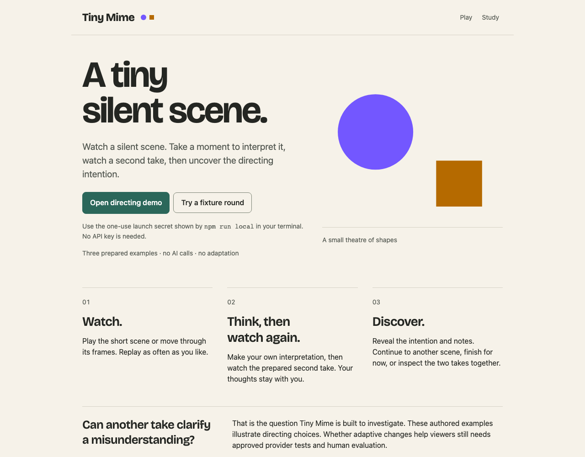
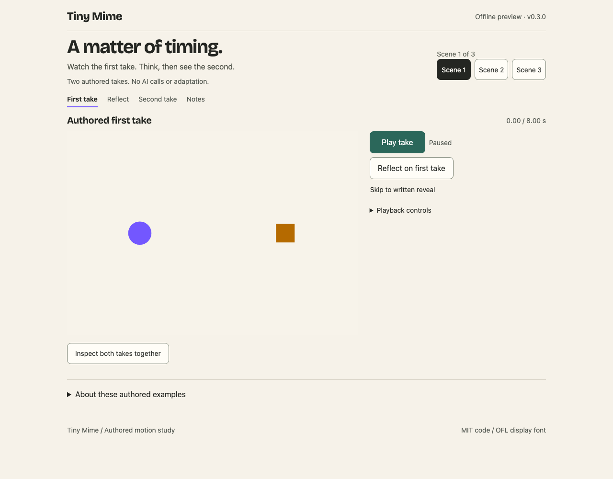
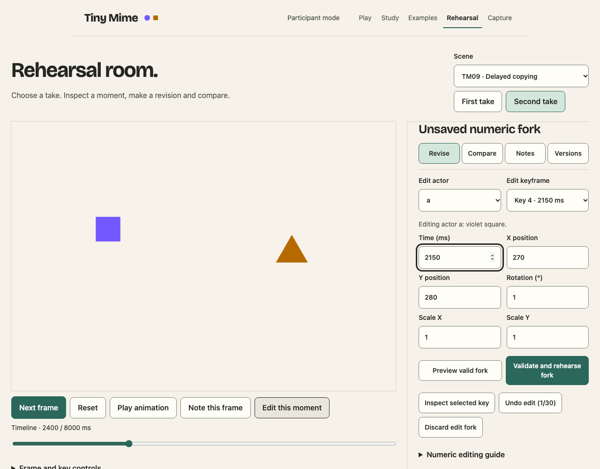
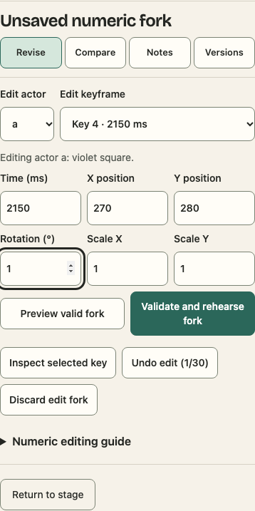
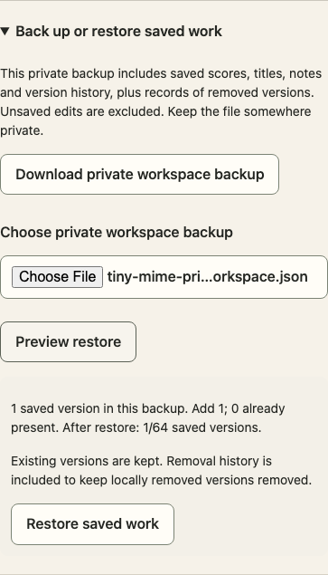
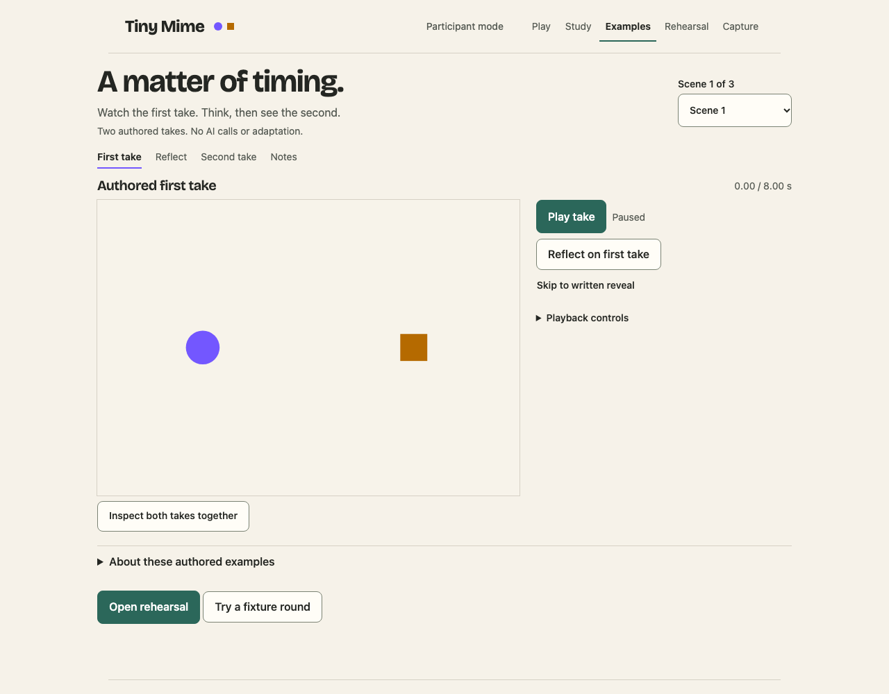

# Tiny Mime

Tiny Mime is a local directing workspace for silent scenes made from geometric
shapes. Start with a prepared take, change a moment's timing or movement, compare
exactly what changed, and save the version with your notes. Keep both takes in an
offline player that needs no installation or account.

The directing examples provide a starting point: watch a first take, reflect on
what happened, then watch a second authored take and reveal the directing choices.
The complete local workflow needs no API key and makes no AI calls.

Separate research tools investigate whether seeing a viewer's guess can help a
director communicate through motion. That effect has not been established. Tiny
Mime is a constrained motion workspace, not a general animation editor.



## Preview without installing

If you received a release bundle, open **tiny-mime-preview.html**. It contains
three authored scene pairs and works offline without an account, server or API
key. Watch each take in turn, with a private reflection between them. Reveal the
notes when ready, or inspect both takes on a shared clock. These prepared
variations do not adapt to a viewer's guess.

To generate the companion preview from source, install the locked dependencies
and run `npm run preview:build`. See [preview controls and provenance](docs/PREVIEW.md).

<details>
<summary>See the offline preview</summary>



*A standalone authored illustration. It makes no AI calls or improvement claim.*

</details>

## Try it locally

Use **macOS, [Node.js 24.15.0](https://nodejs.org/download/release/v24.15.0/) and npm 12.0.0**. The launcher checks exact versions.
Install the pinned Node version with your usual version manager, then select
npm 12.0.0 if it is not already active. Other platforms are unqualified.
No Docker or API key is needed.

```sh
npm run doctor
npm run local
```

`npm run doctor` defaults to setup mode. A setup **PASS** means the pinned Node.js
and npm versions are available and port 4317 can be used by the launcher; it does
not mean dependencies are installed or the app is ready for browser tests. After
installing dependencies, `npm run doctor -- test` also checks dependencies, native
SQLite and all three browser binaries.

Run from an extracted source release or checkout in an interactive terminal.
The launcher installs missing locked dependencies, builds and starts the app.
Dependency installation needs registry access. Open **http://127.0.0.1:4317**,
exactly. Keep the terminal open; Ctrl-C stops the app.

1. Select **Open directing demo**.
2. Enter the one-use launch secret displayed in your terminal.
3. Play the first take, select **Reflect on first take**, then continue to the second.
4. Play the second take and reveal the notes. Choose **Next scene** or **Finish for now**.

Each take starts paused at zero. **Skip to written reveal** is available at any
point. **Inspect both takes together** opens synchronized playback and numeric
comparison. Your reflection is private; this demo collects no response.

To rehearse the complete two-guess interaction, open **Play** and select
**Try a fixture round**. Watch each take, send each guess, then reveal the scene.
**This fixture repeats the first take. It does not adapt to your guess.**
Live adaptation needs separately approved API configuration. Running the demo
silently enables no provider, subscription or real study collection.

The directing demo compares three prepared pairs, varying travel, timing and
pauses. These examples illustrate directing choices without an API key. They are
prepared in advance and make no claim of improved comprehension.

## Make a directing revision

1. Reveal a directing example and choose **Rehearse first take** or **Rehearse second take**.
2. Pause at a moment and select **Edit this moment**. Change a numeric value, inspect
   its key or **Preview valid fork** on the main stage, then **Validate and rehearse fork**.
3. Open **Notes**, give the revision a title and **Save new candidate version**. Saved notes stay
   attached to their original score. The app asks before discarding unsaved work.
4. Open **Compare** and choose a baseline in **Compare with**, or use **Compare
   with parent**. **Numeric changes** shows
   exact stored values and paused links to the affected moments.
5. Select **Download pair inspection ZIP** to keep both scores and their shared-clock
   player. In **Versions**, **Find saved work** reopens a named version with its notes.
6. In **Versions**, open **Back up or restore saved work** to download a private
   workspace backup. Choose a backup and preview what would be added before
   restoring it. Existing versions and unsaved rehearsal edits stay intact.

The directing desk keeps one task open beside the stage on a wide screen.
Switching between **Revise**, **Compare**, **Notes** and **Versions** preserves
your draft. On a phone, all six numeric fields and the preview/validation actions
stay together below the stage, with large touch controls.

This workflow makes no AI calls. Numeric validity and visible differences do not
establish that a revision communicates better. See the [usage guide](docs/USAGE.md)
and [private backup instructions](docs/WORKSPACE_BACKUP.md) before moving saved work.

## What is included

| Workspace | Use |
| --- | --- |
| **Play** | Two takes, explicit guesses, replay, reveal, exit and refresh recovery |
| **Directing examples** | Watch three authored scene pairs in sequence, reflect, reveal and optionally inspect timing |
| **Rehearsal** | Inspect eleven scenes and five references; revise a selected moment, find saved work, compare exact changes and export a pair for offline inspection |
| **Creator Capture** | Download an offline replay with observed creator timing or a labelled score reconstruction |
| **Study** | Synthetic rehearsals for consent, allocation, feedback, coding, retention and analysis |

<details>
<summary>See the Rehearsal workspace</summary>



*An authored fixture, not a model-quality result or participant observation.*

</details>

<details>
<summary>See phone editing and private restore</summary>



*The editor at a 390px browser viewport. Physical-device testing remains unrun.*



*A synthetic saved version, downloaded from the app and restored into a fresh workspace.*

</details>

<details>
<summary>See the directing examples</summary>



*The first authored take. Reflection, the second take and reveal follow by explicit choice. Human comprehension has not been evaluated.*

</details>

Playback supports keyboard controls, scrub, frame stepping and reduced motion.
A hidden tab pauses playback. The stage supports narrow screens and zoom.
Imports use a closed motion language; supplied code and arbitrary assets are not
executed. See the [usage guide](docs/USAGE.md) for controls and troubleshooting.
Saved rehearsal candidates have exact-hash notes, navigable version relationships
and separate single-score or pair inspection exports. Private backup and restore
work while the app is running. Backups include saved titles and notes; inspection
packets exclude them. A restore adds missing versions and rejects conflicts
without replacing existing work. Remove
unneeded versions with no saved children to free tray space.
The active draft is kept. The authored bank and study protocol stay fixed.

Creator capture preserves recorded control timing from one uninterrupted visit.
After refresh or incomplete recording, it exports an explicitly labelled score
reconstruction. See the [capture guide](docs/CAPTURE_RUNBOOK.md).

## API keys and subscriptions

The authored demo works without a key. Live Play/Study uses the Responses API and
needs a server-side API credential, explicit budget and activation evidence.
People running their own copy supply their own approved configuration. This
release provides no shared hosted account.

<details>
<summary>Optional provider and research tools</summary>

The optional Codex subscription diagnostic is a separate owner tool for producing
scores to inspect in Rehearsal. It does not enable live Play, share a ChatGPT
subscription, or qualify the API protocol. See [provider guidance](docs/PROVIDER.md).
Use `npm run provider:readiness` to inspect offline setup requirements and
`npm run support:report` to preview a sanitized environment report. Neither
command contacts a provider. See [operator tools](docs/OPERATOR_TOOLS.md).

`npm run probe:runtime` prepares an offline diagnostic plan. Explicit execution
requires an approved plan hash, secure API configuration and bounded spending
authority. It exercises the actual runtime limits and keeps timing, numerical
validity and human usefulness separate. See [runtime qualification](docs/RUNTIME_QUALIFICATION.md).

</details>

## Privacy and scope

The app listens only on literal loopback. Operator tools need a one-use terminal
secret and separate authorization. No app analytics, remote assets or public
listener are included. Hidden meanings and operator records stay on the server
at runtime. Public source contains the authored bank; source secrecy is not a
research blinding mechanism.

Private rounds expire after 30 minutes of inactivity and disappear on restart.
Study records and downloaded exports have separate retention rules. Keep launch
secrets and real data out of screenshots, source control and shared files.
This tab keeps small recovery receipts for interrupted requests. A withdrawal
receipt contains a code verifier and retry identity, never the code itself;
re-enter the code after refresh. An unknown deletion result stays unknown until
checked. [The recovery boundaries](docs/API_EXTENSIONS.md) explain these limits.
This is a trusted local-computer design, not a hosted or multi-tenant service.
See [SECURITY.md](SECURITY.md), [architecture](docs/ARCHITECTURE.md) and
[research limits](docs/RESEARCH.md).

## Build and verify

```sh
npm ci
npx playwright install chromium firefox webkit
npm run verify:all
npm run audit:dependencies
```

The aggregate checks the specification, types, numeric fixtures, unit tests,
three-browser tests, production startup, client privacy and public source packaging.
Checks use authored/mock inputs with live generation disabled. A source archive
also supports `npm run verify:distribution`. See [development](docs/DEVELOPMENT.md)
for focused commands, the macOS clean-start check and receipts.

Human comprehension, enjoyment, per-scene calibration, semantic-fidelity coding,
actual assistive-technology use, physical-device testing, comparative improvement
and live interactive API qualification are **NOT RUN**.
The CI workflow has no verified remote result until it actually runs.
There is no production-hosting qualification. Software checks cannot establish
those results.

## Prepare a source release

```sh
npm run release:bundle
```

This creates one content-addressed folder containing the history-free source
ZIP, offline preview, provenance manifest, first-use guide and checksums. Bundle
creation reports **PREPARED**; it does not run verification or publish anything.
Run `npm run release:rehearse -- --archive <the-generated-source-zip>` to verify
that exact archive in a fresh temporary install, then inspect its receipt.
The rehearsal removes its temporary install and cache on success or failure.

See [releasing](docs/RELEASING.md) for current-source binding, evidence limits and
the final publication checks. [Changelog](CHANGELOG.md) records the included scope.

## Source and contribution

Start with [CONTRIBUTING.md](CONTRIBUTING.md) and the
[development guide](docs/DEVELOPMENT.md). The retained
[technical specification](Tiny_Mime_Review_Source_Pack/chapters/02_technical_spec.md)
defines the motion language and protocol. [Provenance](docs/PROVENANCE.md) explains
the exact reference subset and file manifest. The source ZIP includes the
contracts and fixtures needed to build and verify the app. It excludes private
development history, implementation plans, review prompts and operator output.

Original code and documentation use the [MIT license](LICENSE). Copied Codex
metadata retains its [Apache-2.0 notices](docs/licenses/CODEX-NOTICE.md).

<sub>This is a personal research and development project. It is not affiliated with, endorsed by, or sponsored by my employer. Any views expressed are my own.</sub>
